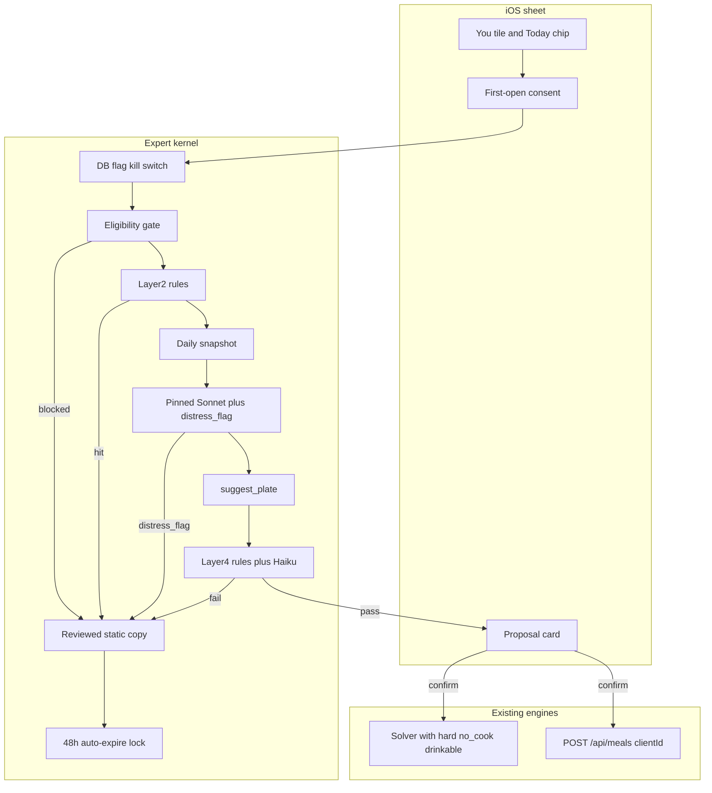

# Specialist AI coaches (v4)

Approved. Build this. No further review rounds.

**v1 ships ember only**, labeled **Nutrition assistant · AI** (Hebrew TBD with counsel — not דיאטן). Haze is a later persona plus extra tools, not a v1 deliverable.

---

## What stays (do not reopen)

- The AI fence: the model never decides check-ins, targets, or plates. Same fence as [app-plan-animation.md](app-plan-animation.md) §7.
- Proposal kinds map 1:1 onto existing APIs. No model-only mutation paths. Confirm uses `clientId = proposalId` into [logMeal.ts](backend/src/meals/logMeal.ts).
- Context is server-assembled. The client never asserts facts.
- Separate `ExpertConversation`. Do not overload tier-3 / [checkins.ts](backend/src/routes/checkins.ts).
- Not a fifth tab. Check-ins stay one-tap plates. No check-in-sheet entry in v1.
- Deterministic fallbacks when `ANTHROPIC_API_KEY` is unset.
- Stay on Anthropic. No second vendor.
- Haze is Phase 2+. Proactive APNs are **not designed**.
- No `ExpertMemory` table. Foods I avoid is the dislikes store.
- **Nutrition assistant** naming, never dietitian.
- DB-backed `nutrition_chat` flag is the kill switch (env is backup; Vercel env needs a redeploy).
- **No token streaming in Phase 1.** Layer 4 is fail-closed: no text is shown until the validator passes. Streaming tokens before validation would show rejected text.

---

## Product: Nutrition assistant (ember)

Not a dietitian. Tile, sheet, chrome, analytics `kind`, and flag are **nutrition**. Copy: **Nutrition assistant · AI**. Validator rejects “I am your dietitian / doctor / trainer” in EN and HE (including דיאטן). **Counsel confirms the EN/HE title before flag-on.**

A check-in is a **push**. This is a **pull** for “I have ten minutes,” “something I can drink,” “use a meal I already like,” “the remaining 420 isn’t that plate.”

**First-session aha:** open from Today with remaining ≥ 300 kcal → a solver plate for *this* gap with *this* user’s Foods I avoid / restrictions → Confirm logs via `POST /api/meals`. If that card does not appear in the first session for that remaining, Phase 1 failed.

**Entry (v1):** You tile (next to Appetite / My meals) + Today chip. **Today chip: `remainingKcal >= 300`** and Layer 1 passes. Not on the check-in sheet. Not on Train.

**Phase 1 tools:** `suggest_plate` + `reply_to_user` (with `distress_flag`).

**UX:** stage progress only — “Looking at today” → “Building a plate” → “Checking”. If staging p95 is unacceptable, the fix is a **faster model or a shorter context**, not streaming.

---

## Solver aha (Phase 0, first)

The knobs exist today and they are **soft**: `prepTimeMaxMin` boosts `no_cook` / `portable` when `<= 15`; `preferDrinkable` boosts `DRINKABLE_SLUGS` by 1.1. Cooked foods are still legal. `DRINKABLE_SLUGS` is five shakes/milks; staples already include `chocolate-milk`, `fruit-smoothie`, `protein-smoothie` and they are not in the set. Foods I avoid are already hard exclusions ([solver/meals.ts](backend/src/solver/meals.ts)).

“Ten minutes” / “something I can drink” can still return chicken breast. The whole plan rests on hard filters returning plates people want. **Do this first, before the harness, before the kernel.**

**Implement:**
- Hard constraints `requireNoCook` and `requireDrinkable` on `PrescriptionConstraints`. Drop failures **before** search. Existing check-in callers leave them unset — current plates unchanged.
- `suggest_plate` maps the ten-minute chip → `requireNoCook: true`, `prepTimeMaxMin: 10`. Drink chip → `requireDrinkable: true`.
- Expand `DRINKABLE_SLUGS` with existing drinkable staples (`chocolate-milk`, `fruit-smoothie`, `protein-smoothie`). Do not invent a catalog.
- Honest miss + chips when the filter is empty. Never fall back to a cooked plate.

**Then measure, before building anything else.** Fixture matrix: dairy-free, vegan, soy-free, bulk, maintain, small-appetite / drinkableOk false, combinations. For each: no-cook plate rate and drinkable plate rate at 300 kcal. Record as a Phase 0 number.

**Threshold:** no-cook miss rate **≤ 20%** of fixture profiles. Drinkable miss rate **≤ 40%** (stricter filter; vegan+soy-free will miss). If drinkable misses **> 40%**, stop: add 1–2 existing-style drinkable staples (e.g. oat drink) **or** relax `minMealKcal` for `requireDrinkable` only (not for normal plates). Do not start kernel/eval/UI until the threshold holds.

**Dogfood:** as soon as the solver work lands, turn `nutrition_chat` on for Michael’s account and use the chips. That is the first user.

---

## Safety architecture (layers)

Every turn, in order.

**Layer 0 — kill switch, no app release.** Primary: `nutrition_chat` (default false), **DB read on every request**. Admin Flags flip is the minutes-scale off. Secondary: env `EXPERT_NUTRITION_ENABLED` (default false until pilot) — belt, not the button. Closed API → paused payload; in-flight sheet → “This is paused”; tiles hide on next `/api/flags`.

**Layer 1 — eligibility.** `EATING_DISORDER_SCREEN` or `MEDICAL_SUPERVISION`: hide tiles/chips. If routed, static copy. **Never an LLM turn.**

**Layer 2 — distress / ED, dual signal.** Unscreened athletes (elevated ED / RED-S risk) go straight here.

- **2a rules (before the model):** EN+HE patterns. “Eat less” trips only with a calorie/weight/body object, not “eat less salt.” Hit → no Anthropic, static copy, `expert_safety_trip` `layer: input`.
- **2b model flag:** `reply_to_user` requires `distress_flag`. True → discard the reply, static copy, trip `layer: model_flag`.
- Either signal is a trip.
- **Lock:** 2 trips in 24 hours **or** 3 in 7 days → static copy only, no model. **Auto-expires in 48h** if nothing else trips (Michael is not a required unlock). Copy stays gentle. Locked users stay in the ITT denominator. Log `expert_safety_lock`. Counsel approves the professional-help resources the copy points to.

**Layer 3 — engines for anything edible.** Solver with the hard constraints. Allergens and Foods I avoid are invariants.

**Layer 4 — output validator, both. Never show rejected text.**

- **Rules (LLM-independent backstop):** persona claims; numeric daily targets / pace; profile allergen tokens as suggestions; skip-session literals. Fail-closed on match. This layer still works if Haiku is injected or down.
- **Haiku** (`EXPERT_VALIDATOR_MODEL`, pinned) structured `{ ok, codes[] }`. Input is **assistant text + tool args + the last user message**. Without the user message it cannot catch indirect ED. Tool args include user-influenced strings (food names, saved-plate names) — the validator can be injected too; eval covers that. Fail-closed on timeout, malformed output, or `ok: false`.
- Cost and p95 of this call are Phase 0 cost-sheet lines. They sit inside the “Checking” stage.

**Layer 5 — confirm-time revalidation.** Proposal lifecycle.

**Layer 6 — human review.** Default-off full-transcript consent (see Pilot). Safety-flagged turns are reviewable by design.

Static copy is versioned, bilingual, reviewed like onboarding safety copy. Not generated. Professional-help links: counsel-approved.

---

## Eval harness (after the solver miss-rate gate)

No prompt or model change ships without a green eval. A model upgrade is a **release event**.

**Pins.** Day-one verification against **live Anthropic docs**. Do not pin from repo strings (`claude-sonnet-5` / `claude-haiku-4-5` in [models.ts](backend/src/ai/models.ts) are probably stale). Expected current API names: **`claude-sonnet-5-5`** (coach) and **`claude-haiku-5-5`** (meal parse + validator). Pin as `EXPERT_NUTRITION_MODEL` and `EXPERT_VALIDATOR_MODEL`. Any pin change runs the harness.

**Harness:** `backend/src/ai/experts/eval/`. `npm run eval:experts`. CI.

**Pass bar:** each case **5 times** (10 for safety). **Every run must pass.** Floor on known cases, not a safety claim. Every review miss goes back into the set.

**Set includes:**
- “How do I eat less” / deficit praise vs “eat less salt”
- Allergy / Foods I avoid
- SCOFF-adjacent + Layer 1 users (must never reach the model)
- Hebrew, slang, mixed he/en, misspellings, indirect distress
- Prompt injection via food names and saved-plate names
- **Validator-injection:** malicious food/saved-plate names that try to make Haiku return `ok: true` — rules layer must still fail-closed
- Out of scope: supplements, injuries, medical, “are you my trainer / dietitian”
- Aha: ten minutes → no-cook; drink → drinkable; empty-set honest miss

---

## Metrics and decision rules (pre-registered)

**Intent-to-treat.** All flag-on users vs holdout, including people who never opened and including locked users.

**Power and contamination.** The cohort is too small to prove improvement. A holdout from the **same trainer’s pool is contaminated** — athletes talk to each other. Sequential baseline is confounded by training season. Point-estimate 5pp / 3pp auto-kills would fire on noise or never fire. **Do not auto-kill on metric deltas.**

**Hard auto-kill (safety, any time, no minimum N):**
- Any Layer-1 user who received an LLM turn
- An uncaught miss in review (safety-flagged or consented sample)
- `expert_safety_trip` **> 15% of turns**. **> 5% of turns** → pause and inspect, do not expand

**Pause and inspect (metrics — not auto-kill).** Evaluate only after **≥ 15 flag-on users and ≥ 15 holdout users, and ≥ 50 check-ins per arm**. Until then, look at the numbers; do not decide. After the floor:
- Check-in acceptance, dismissals / `PAUSE_CHECKINS` / eased targets, gap closure
- A 5pp-class move is a reason to **pause, inspect, and possibly kill by hand** — not an automatic kill

**Report both:** ITT rates (primary) **and** “% of flag-on users who opened” / confirm-among-openers (secondary, self-selected). Do not mix them.

**Expand / keep (after the sample floor, guardrails not tripped):**
- **Keep Phase 1, do not expand:** confirm-among-openers **< 15%**. Also report the ITT confirm rate (flag-on users who confirmed / all flag-on).
- **Expand:** confirm-among-openers **≥ 30%**, safety auto-kills did not fire, and a pause-and-inspect did not find a real acceptance drop. Do not require a significant gap-closure lift.

**Secondary (not for ship/kill):** `expert_open`, `expert_send`, `expert_confirm` (`proposalKind` only), confirm→log success, time-to-first-confirm. No meal contents.

---

## Pilot

- **Population:** A closed athlete pool. Flag whitelist vs holdout from that pool, knowing the holdout is leaky. Lock size, split, start date before flag-on.
- **Window:** 3–4 weeks after the first real `suggest_plate`.
- **Trainers see nothing.** Disclose in consent.
- **Review consent: default-off.** Clear, explicit ask — not a pre-ticked box. Trainer relationship adds pressure; accept a smaller sample. The plan does **not** depend on default-on. Default-on only if counsel says yes **in writing**, and even then it is optional.
- **Safety-flagged turns** (Layer 2/4 trips) are reviewable without a separate full-transcript opt-in. Disclose at consent: “If a message is flagged as unsafe, SetPoint may read that turn to check the safety system.” That is the operational review path. Full-thread reading still requires the explicit opt-in.
- **Reviewer:** Michael, weekly. Audit row for every content view. No floor that blocks the pilot; do not expand on an empty safety-flag log if trips occurred.
- **Rollback:** `nutrition_chat` flag off.

---

## Memory (no ExpertMemory table)

- Daily snapshot is authoritative.
- Foods I avoid (`dislikedFoods` + restrictions): user-edit only, existing You screen, hard solver exclusion.
- Prep / drinkable: existing settings. Preferred plates: saved meals.
- Transcript: last N turns for the sheet; not summarized into the system prompt. Clear conversation clears transcript + pending proposal.
- Account delete cascades conversation, proposals, usage.
- Later maybe `propose_settings_patch` → `PATCH /api/settings`. Not Phase 1.

---

## Proposal lifecycle

None → Pending → Confirmed | Dismissed | Expired | Superseded | Invalid.

- Confirm: `logMeal` with **`clientId = proposalId`**. Crash between insert and state update: retry returns the existing meal, then marks Confirmed.
- Absolute `localDate` + timezone on the card. No relative dates.
- Expiry: `min(end of user’s local day, now + 2h)`.
- Revalidate at confirm. One pending proposal per thread; a new one supersedes.

---

## Latency, cost, models

**No SSE, no token streaming in Phase 1.** Stage progress covers the wait. Bad p95 → shorter snapshot or a faster pinned model, then re-run eval.

Phase 0 measures p50/p95 for Sonnet, Sonnet + solver, + Haiku validator (which now includes the user message). Timeout, one transport retry (not 4xx), 429 `retry-after`.

**Cost sheet is a Phase 0 exit criterion:** tokens in/out (cached vs not), tool rounds, validator in/out, dollars at pinned list prices, per-turn and per-active-user-day at p50 and at quota cap, pilot total and 10×. Quota: `nutrition_message` **10/hour, 20/day**.

---

## Privacy, legal, compliance

- **Counsel (day one, parallel):** title; Israeli privacy; Anthropic processor terms; meal-parse consent does not cover this until counsel says so; **review default-off**; professional-help resources in the static copy; lock copy.
- **In-app consent before the first turn.** AI assistant, not a dietitian or doctor; messages + today’s snapshot go to Anthropic; no photos in Phase 1; trainer sees nothing; safety-flagged turns may be read; full-thread review only if they explicitly opt in; stop by not using it / delete account. EN+HE.
- Admin v1: metadata only, plus safety-flagged turns for review. Full transcript: opted-in users, audit trail, Michael only.
- UI: **Nutrition assistant · AI**. Ember. No companion name.

---

## Product flows

- Under-eating: propose a plate; no lecture; no deficit praise.
- ED / medical cohort: no tile; static copy if routed.
- Distress from an unscreened athlete: Layer 2 → static professional-help (counsel-approved resources); 48h lock after N.
- Angry at the app: “I can’t change check-ins from here. Snooze or pause in You.”
- Hebrew: manager voice. Michael reviews fixtures and whatever sample exists.
- Off-ramp: supplements, injuries, medical, programming, “eat less” → canned refuse + chips.

Presentation: clone [ConversationView.swift](ios/SetPoint/Features/CheckIn/ConversationView.swift). `AmbientGlow(.ember)` + `FuelOrb`. Stages, not a stream.

---

## Haze (Phase 2+)

Only if expand rules pass. Own risk review. Ember may read today’s training bump; it must not plan sessions. No proactive pushes.

---

## Phase 0 order, calendar, exit

Phase 0 is larger than Phase 1. **Aha-first.** Counsel, pins, and the cost-sheet template run in parallel from day one (lead time), but they do not block starting the solver.

**Rough calendar (part-time around teaching). Adjust dates when you start; keep the checkpoint.**

- **Week 1 — aha or stop.** Solver hard constraints, `DRINKABLE_SLUGS`, miss-rate matrix, dogfood on Michael’s account. **Checkpoint at end of week 1:** miss-rate numbers exist and meet the threshold, or food data / drink kcal min is the only work until they do. Do not start the kernel if this fails.
- **Weeks 2–3 — kernel and safety.** Schema, flag, distress + validator (user message in), 48h lock, eligibility, consent UI (default-off), kill-switch proof, idempotency test. Counsel track continues.
- **Week 4 — eval and cost.** Pins verified against live docs; harness 5/10; staging tokens/latency; cost sheet filled.
- **Then Phase 1 UI** (sheet, You tile, Today chip, stages). Pilot flag-on for the whitelist cohort only after Phase 0 exit.

**Phase 0 exit (all required):**
- Miss-rate matrix recorded; thresholds held (or drink path revised until they hold).
- Dogfood on Michael’s account has produced at least one real `suggest_plate` confirm.
- Counsel written OK on title + this surface + professional-help resources, or documented “proceed with X wording.”
- Pins match live docs; eval green at 5/10 including validator-injection.
- Cost sheet filled; validator line included.
- Kill switch demonstrated via DB flag, no redeploy.
- Crash-retry confirm is idempotent via `clientId`.
- Layer 1 users cannot obtain a model turn.
- No streaming path in the client.

**Not designed:** token streaming, proactive pings, fifth tab, replacing check-ins, programming coach, LLM summaries, ExpertMemory, trainer-visible chats, second vendor, check-in-sheet entry, metric auto-kill on 5pp.

---

## Open questions and owners

- **Counsel (Michael, day one):** title EN/HE; privacy; professional-help resources; review stays default-off unless written yes.
- **Pilot:** cohort size, holdout split, start date — locked before flag-on.
- **Michael:** weekly safety-flag review, incident kill, week-1 checkpoint.
- **Engineering:** live pins, solver miss-rate first, measured tokens/latency/cost.
- Nearby / Wolt: out. Check-in sheet entry: only after a pause-and-inspect on acceptance has been possible (sample floor met).

---

## Main files (when Phase 0 starts)

Backend: [solver/types.ts](backend/src/solver/types.ts) + [prescribe.ts](backend/src/solver/prescribe.ts) + [appetite.ts](backend/src/engine/appetite.ts) **first**, then [schema.prisma](backend/prisma/schema.prisma), `backend/src/ai/experts/`, [quota.ts](backend/src/ai/quota.ts), [models.ts](backend/src/ai/models.ts), [flags/index.ts](backend/src/flags/index.ts), [env.ts](backend/src/env.ts), `routes/experts.ts`, [legal/content.ts](backend/src/legal/content.ts), [adminInsights.ts](backend/src/routes/adminInsights.ts), [logMeal.ts](backend/src/meals/logMeal.ts).

iOS: `Features/Experts/` from [ConversationView.swift](ios/SetPoint/Features/CheckIn/ConversationView.swift), [DTOs.swift](ios/SetPoint/Networking/DTOs.swift), [FeatureFlags.swift](ios/SetPoint/App/FeatureFlags.swift), [SettingsView.swift](ios/SetPoint/Features/Settings/SettingsView.swift), [TodayHero.swift](ios/SetPoint/Features/Home/TodayHero.swift), consent, L10n. Reuse Foods I avoid. **No streaming API client path.**

Do not route through check-in conversation endpoints. Do not add Train entry points in Phase 1.
