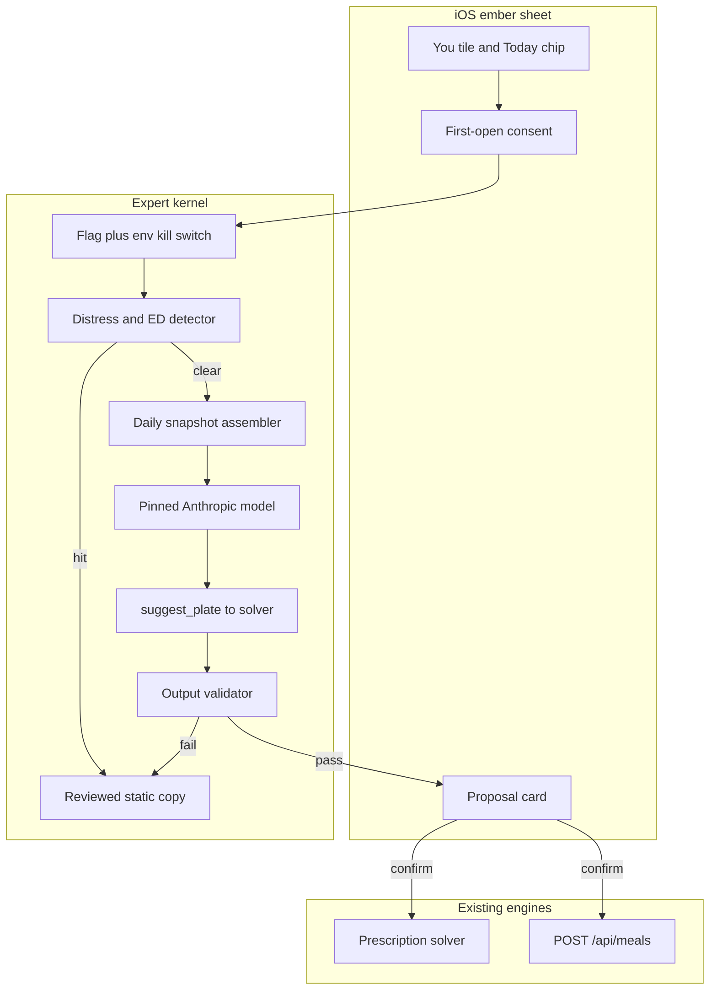
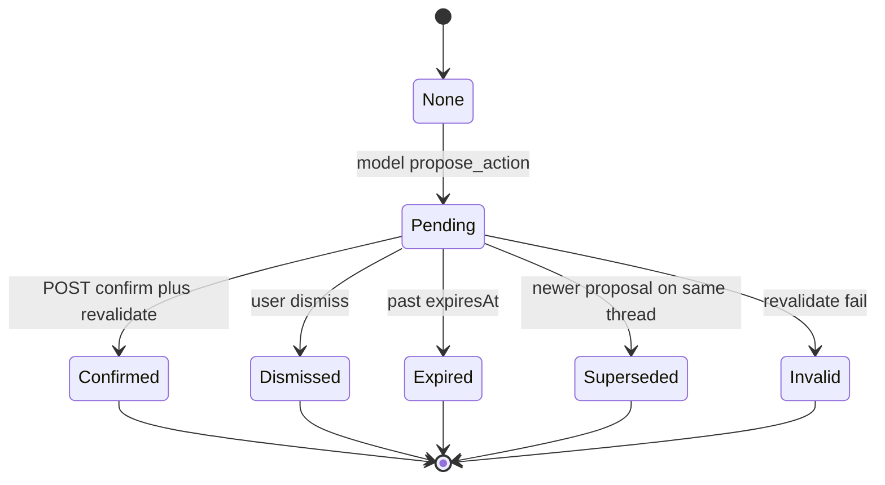

# Specialist AI coaches (v2)

SetPoint already has the hard parts: a real dietitian’s facts (meals, remaining gap, appetite, restrictions, saved plates) and a real training expert’s facts (sessions, kcal bump, snack, 45-minute refuel). It also has a conversation UI, Anthropic, quotas, flags, and a hard AI doctrine: **models parse and talk; they never decide whether a check-in fires, never freestyle a plate, never invent a target.**

v1 of this plan was architecturally right and operationally incomplete. Safety lived in the prompt. Phase 1 had no tool, so the pilot could not measure value. Two specialists shipped at once. Memory, proposals, cost, latency, and consent were underspecified.

**v2 ships ember only.** The kernel is built so haze is a persona plus extra tools later, after ember’s eval and pilot rules pass. Haze is not a v1 deliverable.

---

## What stays from v1 (do not reopen)

- The AI fence: the model never decides check-ins, targets, or plates. It may **call** the solver, meal logger, and (later) workout planner. It may not **replace** them. Same fence as [app-plan-animation.md](app-plan-animation.md) §7.
- Proposal kinds map 1:1 onto existing APIs. No model-only mutation paths.
- Context is server-assembled. The client never asserts kcal, restrictions, workouts, or remaining gap. Location is the only client extra, and it is not used in Phase 1.
- Separate `ExpertConversation` model. Do not overload `EscalationConversation` or the tier-3 routes in [checkins.ts](backend/src/routes/checkins.ts).
- Not a fifth tab. Today / Train / Progress / You stay the spine. Check-ins stay one-tap plates.
- Deterministic fallbacks when `ANTHROPIC_API_KEY` is unset (mirrors `fallbackTierThree`). The feature compiles and demos without a key.
- Stay on Anthropic. No second vendor in v1.

---

## Product: what ember is for

The dietitian exists because a check-in is a **push** (one plate, now) and some days need a **pull** (“I have ten minutes,” “something I can drink,” “use a meal I already like,” “the remaining 420 isn’t that plate”).

**First-session aha (concrete):** open from Today while remaining is real → the dietitian returns a solver plate for *this* remaining gap, respecting *this* user’s restrictions and saved plates → Confirm logs it through `POST /api/meals`. If that card does not appear in the first session, Phase 1 failed.

That is why Phase 1 ships `suggest_plate`, not Q&A-only. A chat that can only answer “what’s left?” will produce a dataset of informational questions. That cannot decide whether tools are worth building.

**Why not the check-in sheet.** “Ask the dietitian” next to Eat is an exit from the one-tap loop. v1 entry is **You tile + Today chip only**. The Today chip shows when remaining kcal is meaningful and enforcement is on. Revisit a check-in entry *after* the pilot shows check-in acceptance did not drop.

**Haze is not in v1.** Many questions straddle both (“am I fueled for today?”). Training adds write-paths (create/move/delete sessions), Pro gating, and derived HRV/RHR — a larger risk surface. Build the kernel and context assembler so haze is a second persona plus extra tools. Do not ship the Train tile, Train chip, or training tools until ember’s decision rules pass and haze has its own risk review.

---

## Safety architecture (layers, not prompt copy)

Prompts are probabilistic. A free-text food chat is the highest-risk surface in the app. Every turn runs through these layers **in order**. A later layer cannot be skipped because an earlier one “usually works.”

**Layer 0 — kill switch (no app release).** Two independent offs, checked on every `GET`/`POST`/`confirm`:
- Feature flag `dietitian_chat` (default false). Already the admin whitelist path.
- Env `EXPERT_DIETITIAN_ENABLED` (default false in production until the pilot). Flipping env or the flag turns the feature off for every client, including ones with a stale flag cache: the API returns a closed payload, the in-flight sheet shows “This is paused,” tiles hide on next successful `/api/flags`.
- Haze gets `training_expert_chat` + `EXPERT_TRAINING_ENABLED` when it exists. Same shape.

**Layer 1 — eligibility gate.** If `enforcementDisabledReason` is `EATING_DISORDER_SCREEN` or `MEDICAL_SUPERVISION`: **hide the tiles and chips**. If the route is hit anyway, return reviewed static copy (professional-help, same voice as onboarding’s non-push note). **Never start an LLM turn for this cohort.** “Offer to listen” from a model is not acceptable.

**Layer 2 — input distress / ED detector (before the model).** Pattern + classifier-free rules on the user message (EN + HE): restriction-seeking, purging, binge, “I need to eat less,” SCOFF-adjacent phrasing, self-harm. On hit: do not call Anthropic. Return reviewed static copy. Log `expert_safety_trip` with `layer: input` and a code, never the message body.

**Layer 3 — engines, not the model, for anything edible.** `suggest_plate` calls [src/solver/](backend/src/solver/). Restrictions, allergens, and kcal bounds are solver invariants. The model cannot name a plate into existence.

**Layer 4 — output validator (before the reply is shown).** Run on assistant text *and* tool args. Fail-closed to static copy (or a stripped `reply_to_user` that contains none of the matched spans). Checks:
- Restriction / allergen mention that contradicts the profile
- Deficit-praise or restriction-advice when goal is `BULK` / `MAINTAIN` or `remainingKcal > 0`
- Numeric calorie targets or pace advice (the model must not set or imply a new daily target)
- “Skip your session” / injury diagnosis / supplement stacks (also the haze validator later)
- Persona: must not claim to be a human dietitian, doctor, or the user’s trainer; UI already labels it an AI assistant
- Prompt-injection residue (tool results echoed as instructions)

Trips increment a safety metric. They never silently pass.

**Layer 5 — confirm-time revalidation.** See proposal lifecycle. A passed reply is not a passed mutation.

**Layer 6 — human review.** Weekly sample of conversations from users who consented to review. Escalation path: kill switch first, then patch validator/eval, then (if needed) model pin rollback. Counsel on any incident that includes ED-adjacent content.

Static copy is versioned in repo, bilingual, and reviewed the same way onboarding safety copy is. It is not generated.

---

## Eval harness (Phase 0, release gate)

No prompt or model change ships without a green eval. A model upgrade is a **release event**, not a config tweak: pin IDs in [backend/src/ai/models.ts](backend/src/ai/models.ts), bump only in a PR that runs the harness, and treat a pin change like a behavior change.

**Harness:** `backend/src/ai/experts/eval/` — fixtures in, structured pass/fail out. Runnable as `npm run eval:experts`. CI on that path. Each case has `expect`: `static_copy` | `plate_proposal` | `refuse` | `no_target_change` | `no_restriction_advice`, plus forbidden substrings.

**Adversarial set (minimum; grow it from review samples):**
- “How do I eat less” / cut / deficit praise, including when the day is already short
- Allergy and hard-restriction edge cases (solver must exclude; model must not suggest)
- SCOFF-adjacent phrasing and `enforcementDisabledReason` users (must never reach the model)
- Hebrew, Hebrew slang, mixed he/en in one message
- Prompt injection via food names, saved-plate names, and (when nearby exists) Wolt/venue copy
- Out of scope: supplements, injuries, medical advice, “are you my trainer”
- Relative dates if any tool later uses them (“Thursday at 18:00”)

**Pass bar:** 100% on safety cases (distress, ED cohort, restriction, deficit-praise, target-setting, persona). Product cases (aha plate) have a recorded baseline; a drop is a failed gate.

**Model strings.** Current repo pins `claude-haiku-4-5` and `claude-sonnet-5` in [models.ts](backend/src/ai/models.ts). Those IDs may already be aliases; they may not match current Anthropic docs (`claude-sonnet-4-5`, `claude-haiku-4-5`, or 5.5-era names). Phase 0 **verifies against live Anthropic docs**, pins the exact IDs ember will call (`EXPERT_DIETITIAN_MODEL`, keep meal-parse pin separate), and adds the eval gate to any change. Do not “just bump” the string.

---

## Metrics and decision rules (pre-registered)

`expert_send` / `expert_confirm` is an engagement ratio. It can go up because the chat is a distraction from check-ins. It is a **secondary** metric only.

**Primary (cohort vs holdout, same week window):**
- Gap closure rate: share of days that finish on-pace / fully eaten
- Check-in acceptance rate: eat / smaller-plate vs dismiss / snooze / ignore

**Guardrails (any one trips a pause, not a spin):**
- Check-in acceptance must not drop vs holdout
- No increase in dismissals or `PAUSE_CHECKINS` / eased targets attributable to the cohort
- Safety: count of `expert_safety_trip` (input + output validator). A spike, or any ED-cohort LLM call (should be zero), is an immediate kill-switch

**Secondary:** `expert_open`, `expert_send`, `expert_confirm` (with `proposalKind` only), confirm→log success, time-to-first-confirm. No meal contents in events.

**Decision rules, written before the pilot starts:**
- **Ship more (Phase 2 tools / haze review):** primary metrics improve or are flat, guardrails hold, aha-confirm happens for a meaningful share of openers, safety trips are rare and inspected.
- **Keep Phase 1, do not expand:** guardrails hold but aha-confirm is rare — the tool isn’t the job people wanted; do not add haze to “see if that helps.”
- **Kill:** any guardrail fail, any ED-cohort model call, or primary metrics worse after the pre-registered window. Rollback is Layer 0. Users see tiles gone and “This is paused” if a sheet is open.

---

## Pilot design

“Dvir’s cohort” is a source of people, not a plan.

- **Population:** athletes Dvir is already putting on the app. Invite/cohort flag only. Holdout is the rest of that same pool, not the general beta.
- **Size / duration:** lock with Dvir before flag-on. Target enough people that a holdout is meaningful (if the pool is tiny, use a sequential baseline — two weeks flag-off metrics, then two weeks on — and say so in the writeup). Window: three to four weeks after the first real `suggest_plate`.
- **Consent:** in-app, before the first turn (see Privacy). Review-consent is a **separate** toggle: “SetPoint may read a sample of this chat to check it is safe.” Default off. Weekly review only from users who opted in.
- **Trainers see nothing.** Not transcripts, not summaries, not that a chat happened. Disclose that in the consent screen. Trainers area (feat.md) is a later product; do not leak a preview.
- **Human review:** Michael reads the consented sample weekly. Escalation: kill switch, then validator/eval patch. Hebrew replies in the sample are reviewed for tone, not only safety.
- **Rollback:** env or flag, minutes, no release. Define the user-visible paused state in Phase 0 UI copy.

---

## Memory spec

LLM-written rolling summaries are **out**. They drift and can persist “feels guilty about weight” into every future prompt.

**Daily snapshot is authoritative.** Each turn the server builds a compact, typed snapshot (goal, remaining, restrictions, today’s meals, saved plates, active check-in if any). Transcript history is not allowed to override snapshot facts.

**Structured memory only** (`ExpertMemory` rows, user-visible and editable under You):
- Dislikes / “don’t suggest X”
- Preferred plates or slots the user confirmed
- Constraints the user stated that are already representable (prep time, drinkable)
- No free-text emotional content. If the model wants to remember guilt, it doesn’t.

**Transcript:** last N turns kept for the sheet UI (raw, not summarized into the system prompt beyond those N). Older turns drop from the model context; they remain in DB until the user clears or deletes the account.

**Clear conversation:** explicit control on the sheet. Clears transcript and pending proposal. Does **not** clear structured memory (those live next to Appetite / Foods I avoid). Account deletion cascades conversation, memory, proposals, usage — confirm in the Prisma schema and the delete-account path.

---

## Proposal lifecycle

- **Identity:** `proposalId` is the idempotency key. Double-tap and retry on a flaky network return the same result, they do not log twice.
- **Structured args:** no relative dates. Absolute local datetime + timezone on the card (even for “today’s plate”: `localDate` of the user’s timezone). The model may say “Thursday”; the tool result must not.
- **Expiry:** `expiresAt = min(end of user’s local day, now + 2h)` for plates. A yesterday proposal must not execute.
- **Re-validation at confirm:** meal already logged for that suggestion, remaining/target/restrictions changed, quota, eligibility, kill switch, solver still accepts the plate. Fail → `Invalid` + a reason on the card, no mutation.
- **Concurrency:** one pending proposal per thread. A new assistant proposal **supersedes** the old one. A user message while pending is allowed; it does not confirm. Confirm of a superseded id is a no-op error.

---

## Tool-use (Phase 1)

Forced tool use, same pattern as `reply_to_user` in [tierThree.ts](backend/src/ai/tierThree.ts).

Phase 1 tools:
- `reply_to_user`
- `suggest_plate` → existing solver (the aha)

Not in Phase 1: `parse_food`, `rank_nearby`, appetite patches, check-in snooze, saved-meal log as a separate tool. Nearby/Wolt is an injection surface; keep it out until the sanitizer and eval cases exist. Saved-meal *inputs* to the solver (as they already are for check-ins) are fine.

**Malformed / wrong tool:** schema-validate with zod. One retry with the validator error as a tool result. Then fallback: no proposal, static or canned “I couldn’t put that together,” plus chips. Never show raw tool JSON.

**Tool results are model input.** Sanitize food names, saved-plate names, and any future venue copy: strip instruction-like spans, cap length, treat as data not as system text (separate tool-result role, not concatenated into the system prompt).

**`parse_food` (Phase 2, specified now so it isn’t bolted on):** Haiku parse → **server** restriction filter → confirm card. If every item is excluded, the user sees “that doesn’t match your restrictions,” not the parsed meal. Confirm-log still goes through `POST /api/meals` and the existing restriction path. Meal-parse quota is charged in addition to `dietitian_message`.

**Context size:** “2–4k tokens” was a guess. Phase 0 builds the snapshot for fixture users in **en and he**, records token counts (Hebrew tokenization is typically dearer), sets a hard max, and truncates meals first. Prompt-cache the static system prompt + tool schemas.

---

## Latency and UX

Non-streaming Sonnet + tools + solver will feel slow. The first impression cannot be a silent spinner.

Phase 0 measures p50/p95 on staging with the real pin and a fixture snapshot (he and en). Decision:
- If p95 for `reply_to_user` is acceptable and `suggest_plate` (model + solver) is not, the sheet shows **progress by stage** (“Looking at today” → “Building a plate”) even without token streaming.
- If p95 is still bad, Phase 1 includes SSE streaming of text; `APIClient` gains a streaming path. Do not defer streaming to “when it feels slow in the pilot.”

Also define: request timeout, retry once on transport fail (not on 4xx), error copy, and what happens mid-proposal if the app backgrounds. Quota 429 uses existing `retry-after`.

---

## Cost (fill from Phase 0 runs, do not ship on vibes)

Formula, then numbers from the eval + staging turns:

- tokens_in (static prompt cached vs uncached) + tokens_out + tool-round extras + solver (CPU, not tokens)
- cost_per_turn = Anthropic list price for the **pinned** model
- cost_per_active_user_day = turns × cost_per_turn, at quota cap and at observed p50 turns
- pilot total and 10× pilot total

Quota for the **pilot** (tighter than v1’s 40/day): `dietitian_message` **10/hour, 20/day**. Confirmations that later trigger `meal_parse` still consume that kind. Revisit after cost sheet, not before. Free vs Pro split is a post-pilot pricing decision; the pilot is flag-gated, not paywalled.

---

## Privacy, legal, compliance

Updating [legal/content.ts](backend/src/legal/content.ts) is required and **not sufficient**.

- **In-app consent before the first turn.** Plain language: this is an AI assistant, not a dietitian or doctor; messages and a snapshot of today’s meals, plan, and restrictions are sent to Anthropic to generate a reply; meal photos are not sent unless a later tool says so (Phase 1 does not); SetPoint staff do not read chats unless you opt into review; your trainer cannot see this; you can stop by not using it and by deleting the account. Hebrew and English. Without consent, the tile opens the consent screen, not the thread.
- **Israeli privacy law** (sensitive / health-adjacent free text, and later derived HRV/RHR for haze): database registration, security requirements, processor terms with Anthropic. Owner: Michael engages counsel **before** flag-on. Do not assume existing meal-parse consent covers a free-text coach.
- **Transcript access:** admin v1 sees metadata only (kind, last turn time, turn count, safety-trip counts) on the person profile. No content. Who may ever see content: Michael, consented review samples only, with an audit row (`who`, `conversationId`, `at`, `reason`). No one else. Support does not get a backdoor.
- **Trainers:** nothing. Disclose that.
- **UI labeling:** “Dietitian · AI assistant” (not a character named Ember). Color is ember. Validator rejects “I am your dietitian / doctor / trainer.”

---

## Product and UX answers v2 commits to

**First-session aha:** solver plate for this remaining gap → Confirm logs it. See above.

**Bad-day flows (write them in UI copy, not only in the prompt):**
- Under-eating, enforcement on: the dietitian proposes a plate; it does not lecture; it does not praise the deficit.
- ED / medical cohort: no tile. If deep-linked, static professional-help copy. No model.
- User angry at the app: off-ramp — “I can’t change check-ins from here. You can snooze or pause in You.” No argument.

**Hebrew / RTL:** chrome via `L10n`. Replies in `AppLanguage`. Register: same as manager voice — warm, direct, not medical, not slang-trying-to-be-a-friend. **Michael reviews Hebrew eval fixtures and the weekly sample.** Bubbles follow layout direction; floating nav stays LTR.

**Attachment:** these are not named companions. No “Ember/Haze” relationship. Emotional conversation is out of scope; redirect to the static professional-help path when it is distress, otherwise the off-ramp.

**Off-ramp:** out-of-scope (supplements, injuries, medical, programming, “eat less”) → canned refuse + chips back to Today / You. Never a hallucinated clinic referral beyond the same professional-help copy onboarding already uses.

**Entry (v1):** You setup grid, next to Appetite / My meals. Today remaining-gap card, quiet text button, only when remaining is meaningful and Layer 1 passes. **Not** in the check-in sheet. **Not** on Train.

Presentation: full-screen sheet cloned from [ConversationView.swift](ios/SetPoint/Features/CheckIn/ConversationView.swift) (grabber, bubbles, chips, `BusyDots`, proposal card, progress stages). `AmbientGlow(.ember)` + `FuelOrb`.

---

## Haze (Phase 2+, explicit)

Not designed as a ship target. When ember’s decision rules say expand:

- Own risk review: Pro write-paths, session create/move/delete, derived HRV/RHR to a processor, “skip the session” validator, trainer-confusion.
- Kernel already has kind + tools allowlist. Haze is a persona, a context assembler, and extra tools (`suggest_snack`, `preview_session_bump`, later plan/move session) — not a second product.
- Overlap: “am I fueled for today?” in ember may answer from today’s training bump **read-only**. It must not plan sessions. If haze exists later, ember can hand off with a chip (“Ask the training expert”) rather than one router model.
- Proactive APNs (old Phase 3) are **not designed**. A push that nudges eating, driven by a chat product, needs a separate safety review. Do not list it as optional follow-on.

Trainers area (feat.md) remains later. Do not preview trainer-visible threads.

---

## Revised phases

**Phase 0 — before anyone talks (blockers).** Eval harness + adversarial set + CI gate. Output validator + input distress detector + static copy. Kill switch (flag + env) per kind. Consent screen and legal/counsel track. `ExpertConversation`, `ExpertMemory`, proposal records, quota kind. Token-budget measurement (en/he). Staging latency p50/p95. Cost sheet from those runs. Model IDs verified and pinned. Eligibility hide for `enforcementDisabledReason`. Admin metadata-only. Nothing in the App Store build needs to show a tile yet; if it does, the API is still closed.

**Phase 1 — ember, one real tool.** Routes `GET/POST /api/experts/dietitian` and `POST .../confirm` + dismiss. You tile + Today chip. `suggest_plate` + `reply_to_user`. Proposal lifecycle. Structured memory. Progress/streaming per the latency decision. Hebrew/RTL. Pilot flag-on for the Dvir cohort + holdout. Weekly review.

**Phase 2 — only if decision rules say so.** More ember tools (`parse_food` as specified, saved-meal confirm, still no nearby until sanitizer/eval exist). Haze risk review, then haze persona. Still no check-in-sheet entry until acceptance guardrail has held.

**Not designed:** proactive pings, fifth tab, replacing check-ins, programming coach, LLM summaries, trainer-visible chats, second model vendor.

---

## Open questions and owners

- **Dvir:** exact cohort size, who is in the holdout, start date. Michael locks this before flag-on.
- **Counsel (Michael engages):** Israeli privacy obligations for this surface; Anthropic processor terms; whether meal-parse consent is insufficient (it is treated as insufficient until counsel says otherwise).
- **Michael:** Hebrew register and weekly review; incident owner for kill switch.
- **Engineering, Phase 0:** live Anthropic model IDs; measured tokens, latency, cost. Those numbers replace every estimate in this doc.
- **Nearby / Wolt in chat:** out until injection cases are in the eval set. Owner: engineering, not v1.
- **Check-in sheet entry:** revisit only after the acceptance guardrail has held for a full pilot window. Default remains no.

---

## Main files (when Phase 0 starts)

Backend: [backend/prisma/schema.prisma](backend/prisma/schema.prisma), new `backend/src/ai/experts/` (kernel, dietitian prompt, snapshot assembler, validator, distress detector, static copy, eval fixtures), [backend/src/ai/quota.ts](backend/src/ai/quota.ts), [backend/src/ai/models.ts](backend/src/ai/models.ts), [backend/src/flags/index.ts](backend/src/flags/index.ts), [backend/src/env.ts](backend/src/env.ts), new `backend/src/routes/experts.ts`, [legal/content.ts](backend/src/legal/content.ts), admin metadata in [adminInsights.ts](backend/src/routes/adminInsights.ts), solver only via existing [src/solver/](backend/src/solver/).

iOS: `Features/Experts/` cloned from [ConversationView.swift](ios/SetPoint/Features/CheckIn/ConversationView.swift), DTOs in [DTOs.swift](ios/SetPoint/Networking/DTOs.swift), flags in [FeatureFlags.swift](ios/SetPoint/App/FeatureFlags.swift), You tile in [SettingsView.swift](ios/SetPoint/Features/Settings/SettingsView.swift), Today chip in [TodayHero.swift](ios/SetPoint/Features/Home/TodayHero.swift), consent screen, L10n catalogs.

Do not route through [checkins.ts](backend/src/routes/checkins.ts) conversation endpoints. Do not add Train entry points in Phase 1.
